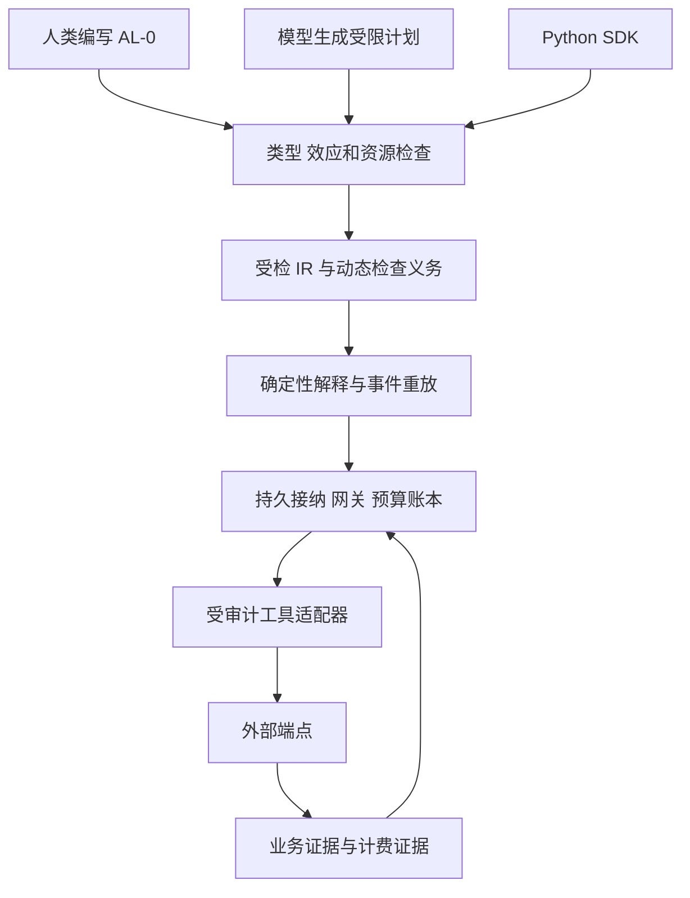

# AL-0 深入研究与设计决策

AL-0 应围绕一个可检验的目标设计：让开发者和模型生成的程序在组合推理、工具调用、并发及恢复时，能够明确表达并检查每个尚未履行的执行责任。核心产物是受检 IR、语言检查器和持久运行时之间的契约。

当前版本为设计草案 0.1，研究日期为 2026 年 10 月 25 日。模型实验已运行；顺序受检 IR、Python SDK 和持久运行时已有参考实现，完整语言及目标定理仍处于规格与证明计划阶段。最新证据见 [实现状态](08-implementation-status.md)。

## 研究定位需要调整

原方案重视 ETAS、LBAC、Quasar、Atomix 和 ASU，方向合理。但新增检索发现两项更直接的公开工作：

- **Fault-Tolerant Budget Conservation in Distributed Multi-Agent Delegation** 已研究故障、迟到完成、重试和委托下的预算守恒，以及运行时到抽象协议的对应条件。[论文](https://arxiv.org/html/2610.00349v1)
- **Authorization for Self-Modifying AI Agent Populations** 已研究替换、分叉、撤销与回滚中的授权守恒。[论文](https://arxiv.org/html/2610.00347v1)

因此，“并发和恢复中的授权与预算守恒”已经有直接近邻。把它作为 AL-0 独占的新问题不成立。新的研究机会在于语言层的可组合规则、编译转换，以及这些规则能否降低现实开发中的错误。该机会仍是待验证的假设。

| 近邻 | 可确认的交集 | AL-0 必须回答的问题 |
| --- | --- | --- |
| [ETAS](https://arxiv.org/html/2607.17780v1) | 效应、请求轨迹、动态检查义务和恢复接口；token 与 attempt 限制属于解释器设施 | 资源与未决操作能否进入组合类型规则及持久化转换证明 |
| [LBAC](https://arxiv.org/abs/2605.12863v2) | 生成程序在外围程序的类型与策略环境中检查 | 独立语法相对宿主语言受检子集有什么额外收益 |
| [Quasar](https://arxiv.org/abs/2506.12202v2) | 内部计算与外部调用分离，支持效应驱动的功能 | AL-0 的额外恢复约束会增加多少生成和修复成本 |
| [Atomix](https://arxiv.org/html/2602.14849v2) | 外部效果的事务式结算、推测执行和冲突控制 | 事务接口怎样与授权、计费和程序类型衔接 |
| [ASU](https://arxiv.org/abs/2610.21063v1) | 具体效果绑定、可信审批展示和单次使用 | 语言值、审批描述与执行器编码怎样保持一致 |
| 预算守恒与授权继承两项工作 | 分布式协议层的资源及授权守恒 | 语言的静态规则、编译正确性和开发收益是否超出协议本身 |

表中只比较已阅读的公开版本，不将未描述的功能记成“不支持”。预印本的声明与本项目运行验证分别登记。完整来源见 [来源登记](07-sources.md)。

## 从原方案推进到哪些新决定

| 问题 | 0.1 决定 | 原因 |
| --- | --- | --- |
| `commit` 同时表示接纳和完成 | 核心分为 `admit`、`inspect`、`await`，`commit` 仅作便利组合 | 崩溃可能发生在接纳成功、客户端尚未获得回复之间 |
| 单一动作状态枚举 | 分为派发状态、业务知识状态、计费状态 | 业务未生效也可能收费，业务成功也可能尚未出账 |
| 恢复靠稳定内容摘要 | 独立持久 slot 映射到 operation，摘要只约束内容 | 相同内容可能是用户确实要求的两次动作 |
| 接纳时检查权限 | 在可信网关的接纳线性化点检查当前授权 | 接纳、排队、发送之间会发生撤权 |
| 仿射值离开作用域即回收 | 句柄销毁不释放未决责任，运行时持续持有 | 栈回收不能取消远端费用和已发出的请求 |
| 费用按逻辑动作预留 | 每次可能独立收费的 attempt 单独预留 | 业务幂等不能推出计费幂等 |
| Python 和 TypeScript 同时首发 | 先 Python SDK，TypeScript 共享协议后接入 | 先建立因果对照，避免生态工程掩盖语义问题 |
| 先铺开全部语言功能 | 先单协调器、结构化并发和有限动态计划 | 可解释所有失败窗口后再扩充分布式委托 |

## 候选研究贡献

**C1 可组合的责任类型。** 定义权限、可消费预算和未决操作的不同使用规则，使模块组合、分支返回、异常与取消都保留尚未结算的责任。重点是“编译时能够指出哪些责任还存在”，并给出对应运行时状态。

**C2 持久化编译的语义保持。** 证明源程序的逻辑动作在 IR、数据库事务和恢复重放之间保持身份、授权绑定与费用覆盖。证明需要覆盖重放、显式重新采样和新分支三种不同含义。

**C3 可测量的开发价值。** 在相同网关、相同检查器、相同权限与计费策略下，比较 AL-0 和强类型 SDK 的实现错误、修复时间和修改回归。若收益主要来自运行时，应将主要成果定位为运行时与 IR。

这三项是候选贡献。只有 C1/C2 完成具体定义和证明、C3 获得实验支持后，才可形成论文主张。当前不声称首次提出 Agent 语言、类型化推理、具体动作审批或故障预算守恒。

## 体系结构

SDK 通过同一 IR 验证器提交计划；宿主代码不能向计划序列化权限对象。运行时从宿主绑定的能力表解析引用，并重新执行必要的动态检查。若 SDK 允许任意直接调用真实服务，该程序已不属于同一保障范围。

## 首版边界

核心覆盖记录与枚举、纯函数、有界循环、封闭效应集合、候选与证据、能力与预算句柄、动作接纳、结构化并发和历史重放。动态计划采用有界、无宿主 FFI 的受检 AST。

无限递归、任意反射、自定义效应处理器、多机自治委托、分布式 actor、自修改运行版本和复杂推理搜索暂缓。长期记忆先作为带来源和标签的普通存储接口；差分隐私另行定义邻接关系、机制和组合器，不混入费用预算类型。

对三类原定工作负载采用共同语义：研究报告检验来源与数据发送；代码修复检验检查证据和原子版本条件；业务工单检验未知结果、重复提交和对账。第一轮实现只需一个假的模型提供器和三个确定性模拟端点，不以真实模型质量阻塞协议设计。

## 主要风险和决策门槛

最重要的工程风险是外部适配器的承诺。若端点不提供条件写入，AL-0 不应导出要求原子版本条件的工具签名。若费用无可执行上界，只能提供软额度监测；若没有去重与查询契约，未知结果后的自动重发必须被拒绝。

最重要的研究风险是与已有协议工作重叠。完成近邻的源码级对照之前，只主张本轮形成了语言设计与验证计划。下一个决策点是：同一组故障是否能由源语言规则明确归责，并在受检 IR 中保持。

实施顺序与实验门槛见 [实验计划](05-evaluation.md)。AL-0 是否需要独立语法，应在首个同运行时对照之后决定，而不是在前端和生态投入完成之后再判断。
