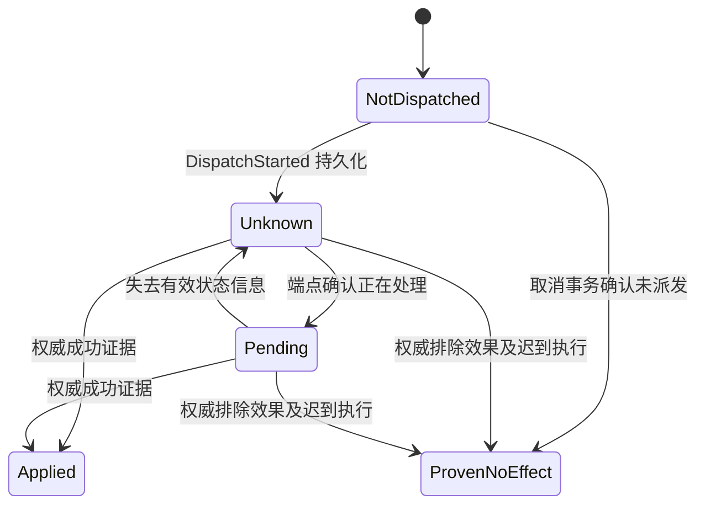

# AL-0 持久运行时协议

本规范定义单协调器的 0.1 参考协议。协调器、授权网关和资源账本使用同一事务存储；工具进程与外部端点位于事务之外。允许进程崩溃、消息重复或丢失、取消、端点迟到和外部版本变化。

存储已确认的事务不会回滚；任意数据库备份回退、网关被攻破和绕过网关的凭据不在保证范围。若部署要容忍整库回退，必须引入外部单调锚点或独立账本，不能沿用本协议结论。

## 三类身份

**Slot** 表示源程序中的一次逻辑激活：`(run_id, program_version, node_id, activation_id)`。`node_id` 由编译器固定；循环迭代、子任务及动态计划拥有持久分配的 activation。恢复读回已有 activation，不根据新的调度顺序重算编号。

**Operation** 表示一次业务意图。首次接纳时分配随机 operation ID，并在同一事务中写入唯一 slot 映射。同 slot、同描述的重复请求返回同一决定；同 slot、不同描述返回 `ReplayMismatch`。不同 slot 可以携带相同内容，因为用户可能确实要求再次执行。

**Attempt** 表示一次可能独立产生收费的外部调用。每次重发创建新的 attempt 和预留，即使服务端复用相同业务幂等键。适配器必须禁用不可见的自动重试，或声明可执行的总发送次数及总费用上界。只有端点明确承诺去重计费时，才可共用对应计费责任。

内容摘要用于比较不可变描述，不用于替代上述身份。摘要碰撞抗性、规范化正确性是绑定机制的前提；审批 UI、网关和实际请求编码必须解释同一组字段。

## Intent 与许可

Intent 包含主体、租户、环境、工具契约版本、规范化参数、artifact 引用、目标资源、版本条件、检查证据引用和数据接收主体。字符串路径应按适配器规则解析资源身份；不能仅靠文本前缀判断路径是否在授权范围内。

Permit 绑定 Intent 身份、授权根、授权版本、允许接纳的 slot 或范围、有效期、最大 attempts、重试类别和政策版本。首次 admission 消耗许可的接纳权；之后重试检查该操作持有的派生权限，不能再把原 permit 当未使用票据。

授权收缩可由当前政策自动施加。扩权来自独立授权主体。已有授权足够时 `authorize` 直接生成具体绑定记录；只有策略要求时才进入人工审批。审批页面从同一规范化 Intent 生成，用户批准后不能重新生成执行参数。这与具体动作绑定的既有工作一致。[ASU](https://arxiv.org/abs/2610.21063v1)

## 原子接纳

逻辑接纳事务同时完成许可消费、首个 attempt 的预算预留、操作记录、slot 映射和 outbox 登记：

```text
BEGIN SERIALIZABLE
  authenticate caller and bind tenant/run
  if decision[slot] exists:
      require exact descriptor match
      return recorded decision
  validate intent, permit, checker receipts and current policy
  require permit unconsumed and retry/adapter contract valid
  reserve upper_bound(first_attempt) in every consumable resource
  insert operation, immutable intent, slot decision
  consume permit into this operation
  insert first attempt and outbox entry
COMMIT
```

不存在“先消费许可再写操作”的可见中间状态。接纳失败且事务未提交，原资源仍可用；提交后响应丢失，客户端查询 slot。拒绝决定若被持久化，应占用该 slot；修订请求使用新的 activation，防止同一键的历史含义被改写。

重复调用返回历史决定不需要仍未消费的 permit，但需要有权访问该 run。返回历史决定也不直接派发：新派发依然经过当前授权检查。

## 网关接纳和撤权的边界

网关在同一事务中检查当前授权 epoch、许可期限、操作和 attempt 绑定、资源占用、取消标志、派发截止时间，并写入 `DispatchStarted`。撤权事务更新 epoch。两者有确定的先后顺序：撤权先提交则禁止接纳；接纳先提交则操作已进入可能对外生效的集合。

这里保证的是**撤权之后不再接受新的受保护派发**。它不保证已接受的请求不会在撤权后到达网络或产生远端效果。若业务要求效果发生时授权仍有效，必须由实际修改端点检查 epoch 或提供等价 fence。单独在本地多检查一次仍有竞态。

有效期和 deadline 同样在这一线性化点判定。可信时间源和重启后的时间处理由部署契约提供；时钟回拨不能延长凭证。首版可以使用数据库或授权服务时间并拒绝不确定的过期判断，不把工作流历史中的旧时间当当前时间。

## 业务状态与计费状态

业务知识状态如下：



`DispatchStarted` 在实际发送之前写入。因此进程可能崩溃于写标记后、发送前；恢复仍必须保守视为 Unknown。没有端点证据，就无法区分“未发送”与“发送后丢了响应”。

每个 attempt 的计费独立经历 `Reserved → Settled` 或 `Reserved → Retired`。operation 汇总所有 attempts 的 confirmed、reserved 和 retired；这三个量可以同时非零。业务 `Applied` 不自动完成计费；业务 `ProvenNoEffect` 不自动清零费用。查询、推理失败、验证失败和被端点拒绝的调用都可能收费。

业务结果证据必须绑定 operation、effect digest、接收端点和最终性。计费证据必须绑定 attempt 或明确覆盖的 attempts 集合、资源维度、费用和最终性。账单明细的“截至目前为零”不代表最终免费。

终态证据重复到达，返回已记录决定；冲突证据不能覆盖原终态，应冻结后续自动动作并进入适配器错误处理。补偿操作是新 operation，不能把已经 Applied 的历史擦成未生效。

## 预算代数

对每个根预算和累计资源维度，定义：

```text
B = F + R + C + Q
```

F 是所有分配中尚可花费的额度之和；R 是尚可能收费的 attempt 预留；C 是已确认累计支出；Q 是主动退休但不再可用的额度。所有量非负，父分配和子分配不得重复计数。

典型转移：

```text
reserve(u):    F -= u; R += u
settle(u,c):   R -= u; C += c; F += u-c     where 0 <= c <= u
retire(u):     R -= u; Q += u
delegate(u):   F_parent -= u; F_child += u
```

R 转成 Q 后只能追加晚到的事实注释，不再释放为 F。报表可以单独展示后来确认的实际费用，不能同时把同一责任重复计入 C 和 Q。

在每笔收费都受介导、每个 attempt 有可靠上界且结算最终性成立时，实际累计费用满足 `actual ≤ C + R + Q ≤ B`。上界被供应商违约突破时，运行时应记录实际超支并停止新接纳；不得截断实际费用以伪造不变量。

不同资源有不同收费时点：调用次数可以在 DispatchStarted 时消耗；token 和金额可能在最终账单结算；业务配额按 operation 消耗；并发槽位属于可归还容量，不与累计支出放在同一个 C 中。维护独立的 `active ≤ capacity` 不变量，并声明 active 指本地 worker、网关请求还是实际远端作业。

子任务取消只归还 F；R 与 Q 仍归根预算。资源等待队列应有公平策略，但预算安全不推出不会饿死。首版禁止持有多个不同预算锁等待，使用单事务接纳避免锁顺序死锁。

## 重试和适配器契约

| 契约项 | 必须回答的问题 |
| --- | --- |
| 业务去重 | 哪个键、哪个作用域、保留多久、相同键不同内容如何处理 |
| 计费 | 每个物理发送的上界、失败和去重请求是否收费 |
| 结果查询 | 能否权威查询当前结果，NotFound 是否最终排除未来执行 |
| 取消 | 取消确认覆盖哪些尚在队列或执行中的工作 |
| 条件写入 | 检查哪些版本，是否与实际修改原子进行 |
| 身份与规范化 | 租户、工具版本、资源别名和权限相关字段如何绑定 |
| 请求编码 | 请求体或内容引用是否仍可能变化 |
| 传输重试 | SDK、代理或客户端内部是否还会额外发送 |

适配器分三类使用：

1. **条件写入且可去重查询**：支持相应版本保证和受控重发。
2. **可去重但缺少原子条件写入**：可减少重复业务效果，不能宣称防止陈旧写入。
3. **无可靠去重或查询**：发送开始后未知即保留，不自动重发；由显式对账或人工业务决策处理。

`NotFound` 可能只意味着尚未可见。只有端点同时排除旧请求未来被接受，并证明没有既有结果，才可产生业务 ProvenNoEffect。去重保留期结束后，旧 key 不再自动提供去重保证。

官方 API 的幂等行为也可能按版本不同。Stripe 文档区分 v1 保存首次结果与 v2 对失败或部分失败工作的处理；因此签名应绑定具体契约版本，而非只有 `idempotent=true`。[Stripe](https://docs.stripe.com/api/idempotent_requests)

## 崩溃窗口

| 崩溃位置 | 已持久事实 | 恢复行为 |
| --- | --- | --- |
| 接纳事务提交前 | 无新操作和消费 | 回滚事务，可重新执行同 slot |
| 接纳提交后、回复前 | 操作、消费、预留和 outbox 完整 | 返回同 slot 决定 |
| outbox 尚未取得派发权 | Queued | 可取消并释放未发送 attempt 的预留 |
| DispatchStarted 后、实际发送前 | 请求可能已外发 | 进入 Unknown，按契约查询或受控重发 |
| 远端生效后、回执到达前 | 本地未知，外部可能已变更 | 不重新授权为新动作；对账同 operation |
| 业务回执已入库、费用未确定 | 业务终态，计费预留 | 保留预算责任 |
| 费用结算事务中 | 原子前态或后态 | 按证据唯一键幂等结算 |
| 子任务取消后、晚到收费前 | cancel_requested 与 R | 继续接管和结算 |

持久工作流的历史恢复与外部活动的交付保证是不同层。已有 Durable Task 文档也明确 activity 的至少一次执行要求调用方处理幂等性。[Microsoft Learn](https://learn.microsoft.com/en-us/azure/azure-functions/durable/durable-functions-types-features-overview)

## 恢复与升级

`audit replay` 只读历史并关闭外部派发；`resume` 使用原运行版本和操作身份；`resample` 创建新的推理激活和费用责任；`fork` 创建新分支并显式分配权限和预算。

旧 checkpoint 恢复局部控制状态，不覆盖权限消费、预算、撤权 epoch 或操作表。活跃程序版本默认固定。迁移必须提供旧新 slot 映射、schema 转换和未决操作保留规则；若映射不能保持身份，停止迁移并继续用旧解释器处理未决项。

“回滚整个数据库快照后继续上线”不是 workflow resume，不能声称消费记录依然有效。

## 数据库逻辑结构

| 表 | 关键唯一约束 | 原子关联 |
| --- | --- | --- |
| runs | run_id | 程序版本、计划版本、宿主主体 |
| slots | run_id, program_version, node_id, activation_id | 决定、Intent、operation |
| permits | permit_id | consumed_by_operation 只写一次 |
| operations | operation_id | 不可变 Intent 与业务终态 |
| attempts | operation_id, attempt_sequence | 费用预留、派发标记、端点契约 |
| budget_accounts | root_id, allocation_id, resource | F/R/C/Q 及分配关系 |
| settlements | provider, evidence_id | 唯一结算与 attempt 覆盖 |
| outbox | attempt_id | 持久待派发项 |
| authority_epochs | grant_id | 当前 epoch 和撤销记录 |
| events | run_id, sequence | 已提交事务内的事件序列 |

SQLite 可用于单协调器原型，要求实际配置和检验所需持久性；PostgreSQL 可作为后续并发部署后端。首版不把某种数据库的默认配置当作崩溃持久性的证明。源码中的 SQL 事务与抽象原子转移需要逐项对应。

## 对账服务和运行结束

运行状态分 `Running`、`Waiting`、`CompletedClean`、`CompletedWithObligations` 和 `FailedWithObligations`。任务返回成功不等于账本已清空，UI 应显示仍未确定的业务操作或费用。

对账本身有成本。初始预算可以划出一份对账储备；若储备用尽，保持未知并等待后续资金或人工证据，不能隐藏使用另一个无限预算。对账服务接管操作，不复制根额度。

跨多个端点的批量动作返回逐项 Applied、ProvenNoEffect 和 Unknown；没有端点级分布式事务时不提供全局原子成功。补偿也单独授权和计费。此边界与 Atomix 讨论的多端点外部效果问题保持一致。[Atomix](https://arxiv.org/html/2602.14849v2)
