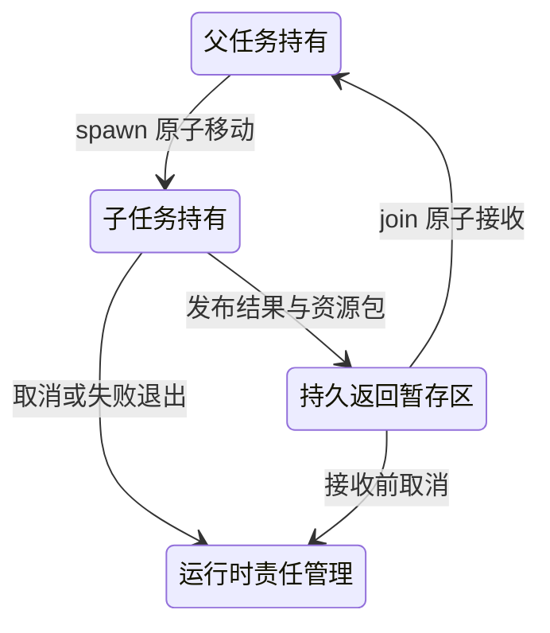

# 跨任务仿射资源：控制权、费用归属与持久返回

更新日期：2026 年 10 月 26 日。

本设计覆盖 Permit、Operation 和 Budget 的跨任务输入、返回与退出责任，首先完成协议模型与 schema 16 的 attempt 资金归属。后续 [schema 17 可信 Store 接口](28-durable-resource-custody.md) 已接通真实控制权与暂存返回；后续 [受检任务接口](29-checked-task-resources.md) 已支持命名仿射参数和单资源返回。本页保留协议模型及其边界，最新实现状态见后续文档。

## 从现有实现得到的约束

本轮改造前，`TaskMixin._task_operation` 根据 Operation 的资金 allocation 推导所属任务，再检查 worker lease。`Store.retry`、`_release_queued` 和 `settle` 使用同一 `operation_allocations` 记录确定预留和退款归属。`TaskMixin._release_task` 根据 allocation 子树选择需要取消的操作，并合并该子树。对于当前不跨任务移动仿射资源的接口，这些关系保持一致。本轮已将退款及分账户统计切换到 attempt 级记录；任务控制和默认重试资金选择尚未改变。

开放移动后，需要区分三个问题：

1. 谁现在可以控制资源、派发或重试？由当前 custody 及任务 worker epoch 决定。
2. 某次尝试已经从哪个账户预留了多少钱？由该次尝试的不可变出资记录决定。
3. 来源任务结束时，谁还承担未决业务和费用？由当前控制权和持久责任登记决定，不能只扫描资金树。

直接增加 IR 的允许类型集合不足以实现移动。把 `operation_allocations` 改成目标任务的 allocation 也不正确：它会改写已暴露尝试的退款归属。保留该指针、却继续用它检查 worker lease，又会使接收任务无法控制操作。

## 对象与动态义务

以下为协议持久结构。AttemptFunding 由 schema 16 的 `attempt_allocations` 与既有 attempts.upper_bound 实现；后续 schema 17 以 resource_custody、task_resource_inputs 和 task_resource_returns 接入其余核心记录。这里的记号不要求数据库采用同名表。

```text
Custody(run, resource_kind, resource_id,
        owner_kind, owner_id, generation, state)
Worker(task_id, epoch, task_state)
Transfer(run, transfer_key, descriptor, result_envelope)
ReturnEnvelope(task_id, result_descriptor, resource_manifest, state)
AttemptFunding(attempt_id, allocation_id, upper_bound)
```

`owner_kind` 可为执行主体、返回暂存区或运行时责任管理者。每个资源只有一条当前控制记录；别名、只读视图和历史结果不新增记录。`state` 区分可操作、已消费、已退休等状态。这里只把表名作为协议记号，后续实现可合并部分表，但不能省略相应原子条件。

跨边界的可操作引用包含 `(run, kind, id, generation)`。请求还携带当前执行主体及 worker epoch。每次开始新工作，都要在同一事务中验证：

```text
CurrentCustody(resource, actor, generation)
CurrentWorker(actor, epoch)
ResourceUsable(resource)
CurrentAuthority(intent, grant_chain)
CompatibleSink(value_labels, control_labels, endpoint)
```

generation 和 worker epoch 解决不同问题。资源经过父→子→父后，owner 名称又相同，但旧父引用已失效，必须由 generation 排除 ABA。任务崩溃后资源可能没有移动，但旧 worker 必须被新 epoch 排除。二者不能互相替代。

Permit 继续绑定具体 Intent、grant chain、有效期和尝试上限。移动不会重签许可、刷新期限或扩大权限。Operation 的业务身份、端点幂等键及已经记录的尝试不变。Budget 移动改变控制者，不复制余额，也不重接资金父链。OpRef 仍可复制读取，不因此获得控制权。

## 原子资源包与任务输入

静态接口使用 `Task<T, Δreturn>` 表示普通结果和可返回的仿射资源集合。实现可隐藏这个元层记号，但不能把多个资源装进普通 Json 来绕过消费检查。

资源包必须具有受检 manifest：每个字段的资源种类、工具/预算类型、真实资源 ID 和预期 generation 都已确定。Permit 字段还依赖同包或显式可复制环境中的对应 Intent。不同字段不能指向同一仿射资源；动态别名也必须在事务前完整检查。任务输出资源包、结果分支和循环资源状态将复用此描述机制。

创建任务的单一事务需要同时完成：

1. 检查源 worker、源 custody、具体资源绑定、完整输入、资金和权限边界。
2. 写入任务身份、程序指纹、固定输入、固定权限表和控制标签。
3. 创建本次真正需要的新资金分配；已有 Budget 的移动不得再按其面额 split 一次。
4. 对包内所有资源执行预期 owner/generation 的条件更新，递增 generation。
5. 保存 transfer descriptor 及接收方引用，提交后才允许调度 worker。

任一项失败时没有部分转移。相同 transfer key 的相同描述读取原结果；变更字段、目标、资源、generation、程序、权限或金额必须拒绝。子任务使用的 ambient budget 与显式传入的 Budget 应分别登记，禁止同一资源同时作为两种独占输入。

## 持久返回与 join

完成工作不直接把资源交给父任务。需要一个暂存阶段：



发布事务把导出的全部资源移到暂存区，同时保存结果描述。子任务从此不能再使用这些资源；父任务也尚未取得控制权。join 事务检查接收者仍可接收，消费返回包，并把每项资源的 owner/generation 一起更新。崩溃发生在发布与 join 之间时，资源有明确的持久持有者，不丢失，也不被双方同时使用。

普通 `TaskRunner.run` 读取已完成任务，只能取得返回包的历史观察，不能把其中的资源值直接视为父方可操作返回；这一点已在后续单资源返回路径实现。TaskScope.join、Completed 结果分支和 race winner 的接收都需要同一个受检接收协议。

已成功 join 的重复请求返回历史结果，不再次递增 generation。若资源随后又移动到其他任务，重放旧 join 也不能把它重新安装到父任务。执行器可以使用历史引用重建已提交的计算轨迹；**新的资源操作**仍必须验证当前 custody。重放匹配应先识别同一持久请求并读取历史决定，不能把“历史已成功”和“现在有权新增操作”混为一谈。

对于 race，winner 选择、winner 返回包接收、loser 的控制权隔离应在同一事务确定。未选中的资源不得通过候选结果旁路泄漏；推测任务的共享写入限制继续生效。该一般 race 扩展尚未进入本轮有限模型。

## 取消、失败与责任

取消事务递增被取消执行主体的 worker epoch，并按**当前 custody**处理仍归其持有的资源及尚未接收的返回包：

| 资源 | 退出处理 | 后续事实 |
| --- | --- | --- |
| 未消费 Permit | 退休或进入明确不可继续授权的运行时状态 | 不因重放或取消自动复活 |
| Operation | 交给运行时责任管理，禁止原 worker 新派发/重试 | 已暴露的请求仍可能产生业务结果和费用 |
| 尚未暴露的 queued attempt | 在同一退出事务关闭并释放其预留 | 释放记录必须按 attempt 去重 |
| Budget | 关闭当前归该退出路径持有的预算接口，合并可用余额 | 已预留金额不转成可用余额 |
| 已被父任务接收的资源 | 不再属于这个子任务的清理集合 | 不按原 allocation 子树误取消或误关闭 |

父任务或更高层作用域整体取消时，还需沿**任务责任树与当前 custody**处理后代；资金树不提供充分的控制关系。返回给父任务的资源仍受父任务及其所在作用域的生命周期约束，并未逃出整个结构化作用域。

运行时接管只保留责任，不默认获得重新派发权。独立对账仍是一个需要当前权限和预算的新查询操作。以后若提供 `adopt`，必须显式验证当前授权、状态、资金、标签和新接收者，再建立新 generation；它不能作为恢复旧许可的后门。本轮不实现 `adopt`。

已失败任务的资源也不能作为普通异常字符串泄漏给父任务。若需要返回可继续使用的资源，应由受检的资源结果分支明确表达并经接收事务处理；否则交给运行时处理责任。现有 `TaskOutcome` 与多资源 sum type 必须共同扩展。

## 出资与结算

对每次尝试 a，固定 `AttemptFunding(a)`。移动 Operation、发布结果、join、重放和 worker 恢复都不修改该记录。

本协议选择让**新尝试显式指定当前控制者可用的 Budget**。因此，同一 Operation 的两次尝试可以由不同 allocation 预留，但各自的预留和结算分别归属原账户。v16 的 Store.retry 只有固定操作账户；后续 schema 17 已增加可选 allocation，并检查当前控制者和账户状态。默认行为保留原账户，但不能隐式使用来源任务的钱。

派发已经预留的 queued attempt，验证的是 Operation 当前控制权与当前授权；不得因为转移又收取一次预留。新增重试则同时检查 Operation 和选定 Budget 的控制权，以及原有去重窗口、尝试上限和业务状态。

迟到退款沿该次尝试的固定 allocation 父链寻找仍开放的账户。账户控制权可以变化，资金父链不变；已关闭的祖先不会因迟到退款重新开放。若导出的 Budget 仍开放而来源作用域关闭，不能无条件合并整个 allocation 子树。任意深度、部分关闭的树需要额外验证；本轮模型只包含 root 的两个直接子账户。

每个资源维度继续满足：

```text
Total = Free + Reserved + Confirmed + Retired
Free = 所有开放 allocation 的可用余额之和
```

总额守恒本身不足以证明分配正确。把 A 的退款错记到 B，也可能保持 Total 不变，因此还要检查每个 allocation 与其不可变预留/结算来源的一致性。

## 有限模型与反例

运行：

```powershell
python -m models.affine_transfer
python -m unittest tests.test_affine_transfer_model -q
```

模型源码为 [affine_transfer.py](../models/affine_transfer.py)，机器结果为 [affine_transfer_results.json](../models/affine_transfer_results.json)。全图含 **1,629 个状态、5,174 条允许转移**，所检查不变量无违规，10 项专项测试通过。拒绝请求按种类计数，四条非空进展轨迹均实际到达：跨账户重试后返回、取消后迟到费用、未使用许可返回后接纳、暂存区取消时分别处理 queued 与 exposed 尝试。

| 故意引入的错误 | 最短反例的核心动作 | 观察到的违规 |
| --- | --- | --- |
| spawn 只移动包中的部分资源 | spawn | 接收方输入与当前 owner 不一致 |
| 发布时直接赋权父任务 | spawn → publish | 接收前获得返回资源 |
| 重放旧 spawn 恢复旧 owner | spawn → publish → replay | 资源从暂存区被重新赋予子任务 |
| 只核对 owner，不核对 generation | spawn → publish → join → 旧引用请求 | 父→子→父 ABA |
| 不核对 worker epoch | crash → recover → 旧 worker 请求 | 恢复前 worker 仍可新增工作 |
| 移动时改写 attempt 出资账户 | parent admit → spawn | 已预留尝试的资金来源改变 |
| 按当前控制者选择退款账户 | spawn → 从 A 接纳 → 派发 → 端点完成 → 计费 | 总额守恒但账户归属错误 |
| 按资源的来源任务清理 | spawn → publish → join → cancel child | 关闭父任务已接收的资源 |
| 取消释放 exposed 预留 | spawn → admit → dispatch → cancel | 已暴露费用失去覆盖 |

每个错误变体均保存具体动作序列及终态；测试重放该序列并验证对应违规。同序列在正确规则下保持安全或被拒绝，不把无关报错计为成功。

模型范围固定为一个父任务、一个子任务、一个具体许可与动作、两个预算账户、最多两次尝试、一次协调器崩溃/恢复。根总预算 6，每次预留 2、实际费用 1。模型用统一恢复 epoch 表示这次恢复，不覆盖独立多 worker 恢复调度。端点执行可在协调器宕机期间继续，计费证据在恢复后应用。

包内移动采用固定集合，没有枚举任意别名、嵌套包或一般结果类型。每资源单一 owner 由单记录状态编码保证，不能据此宣称数据库并发条件更新已验证。授权链、principal、标签、schema 和端点事实正确性作为前提；事务是原子转移；模型没有 SQLite 故障注入、实际线程、父作用域整体取消、多任务 race、任意预算树或全语言证明。进展轨迹说明安全规则允许有效执行，不证明任意调度下最终完成。`runtime_integrated: false` 在结果中显式保留。原有撤权/取消/重试组合模型的结论不能自动拼接成这里的组合证明。

## 接入运行时的具体改造与验收

### 已完成的出资记录基础

schema 16 增加 `attempt_allocations(attempt, allocation)`，attempt 为主键，双方都有外键。更新已有映射被不可变性触发器拒绝。创建 attempt 时，记录与预留、许可消费、operation、outbox 一起提交；失败时一同回滚。当前默认重试依然使用 Operation 原资金账户，但也为每次新尝试单独保存这一事实。

`settle`、queued 释放和 `allocation_tree` 读取 attempt 记录。`Store.attempt_funding(attempt, principal)` 提供经过 principal 检查的历史查询。缺失资金记录时，结算和分账户统计显式失败；不会在收到回执时临时从操作指针猜测来源。结算中的费用、证据和事件写入随失败回滚。

从版本 2 至 15 的迁移在同一事务内创建结构、依据原有固定操作账户导入每个 attempt 的来源，并更新版本。v15 的非根账户保留原 ID；更旧版本先执行已有 allocation 迁移，再导入 attempt 来源。迁移不改变根账本余额、程序指纹或任务权限边界。

`tests/test_attempt_funding.py` 的 12 项测试覆盖接纳/重试记录、不可变性、授权查询、原账户退款、queued 释放、关闭账户后的迟到退款、缺失记录回滚及迁移。五个真实进程退出情形分别位于接纳资金记录写入后、接纳提交后、重试资金记录写入后、迁移提交前和迁移提交后。迁移前退出保留 v15 并回滚新表；提交后退出保留 v16 与导入记录，恢复不重复处理。

另有测试故意扰动旧 `operation_allocations` 指针，检查已存在 attempt 的退款及统计仍归原账户。这是区分新旧查询路径的存储边界实验，不是受支持的控制权转移。完整回归证据见 [实现状态](08-implementation-status.md)。

### 尚需接通的控制权与语言入口

下表是协议提出时的完整接入清单。schema 17 已完成可信 Store 的移动、暂存、接收及当前控制权检查；TaskScope/TaskRunner 的受检参数与单资源返回也已接通；多资源包已在 [受检资源包](31-checked-resource-bundles.md) 接通，资源结果分支仍待实现，逐项证据见 [运行时接入报告](28-durable-resource-custody.md) 与 [受检任务接入](29-checked-task-resources.md)。

| 位置 | 必须改变的职责 | 必须取得的证据 |
| --- | --- | --- |
| ir.py、sdk.py、source.py | 受检资源包、输入移动、返回包、分支接收；保留具体 Intent 依赖 | 拒绝重复别名/二次消费/错 intent；源码与 SDK 相同 IR |
| TaskScope.spawn、Store.spawn_task | 输入、权限表、预算选择及 custody 同事务 | 各写入边界进程退出；回滚无半包；重放无重复分资 |
| TaskRunner、finish_task、join_task | 发布暂存包与原子接收；历史观察不可直接授权 | 发布后退出、接收后退出、重复 join、接收后再次移动 |
| start_attempt、retry、admit | 当前 custody + 当前 worker + 当前授权；重试显式出资 | 旧任务、旧 generation、旧 worker、已撤销 grant 均拒绝 |
| allocations、settle、queued release | 已完成不可变 attempt funding 及旧数据导入；仍需跨控制者的显式新尝试出资 | 已有多维退款、迟到/重复回执与迁移测试；仍需真实移动后的双账户调度 |
| _release_task、close_scope | 按当前控制权清理，保留已导出资源及暴露责任 | 取消与接收竞态；来源任务关闭不损坏接收者 |
| take_task_outcome、select_race | 资源结果分支和 winner 接收与 loser 隔离 | 每个候选都可能胜出、失败、等待或被取消 |
| migration、恢复入口 | 版本化 custody 语义，不猜测旧资源持有者 | 旧 run 行为和新 run 行为分别可复现 |

旧版本所有尝试使用对应 Operation 的固定 allocation，因此可从这一历史不变量导入 attempt funding。旧 Permit 并未记录可靠的来源任务 custody，不能靠授权字符串或当前 worker 猜测。迁移应逐项验证可推导信息，缺失信息保留旧语义或要求显式迁移证据；不能把“数据库表建好了”视为旧运行已经可安全继续。

尚余验收完成前，不放宽当前跨任务类型白名单。本模型是确定实现约束的前置证据；已完成的出资记录也不能替代后续 custody/返回包的真实并发、进程退出与模型对应检查。

## 证明义务与已有基础

拟证明的局部引理包括：单条 custody 记录及条件更新保持唯一控制者；包转移的单事务保持 all-or-nothing；generation 与 epoch 联合排除旧引用和旧 worker；固定 attempt funding 使任意控制权移动与费用结算相互独立；取消只释放未暴露预留；历史重放不产生新赋权。完整证明还需把静态资源环境、运行时引用和这些记录建立对应，处理嵌套任务、循环、资源结果分支及任意账户树。

所有权和移动已有成熟语言基础；例如 [Rust 官方所有权说明](https://doc.rust-lang.org/book/ch04-01-what-is-ownership.html) 明确介绍单一所有者和移出作用域后的资源处理。这里需要额外处理的是持久外部责任和跨崩溃的当前控制权，不能直接把内存值 drop 等同于外部动作撤销。

[SQLite 原子提交文档](https://www.sqlite.org/atomiccommit.html) 给出单事务全有或全无的存储基础，并说明其文件系统及硬件假设。该页面主要讨论 rollback journal；实际 AL-0 使用的存储模式、同步配置及故障注入仍需单独验收。本文不提出新的数据库原子性算法，也不以有限模型代替真实存储验证。
