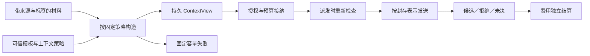

# 持久 ContextView 与模型输入契约

状态：设计，尚未接入实现。本文将原方案“显式上下文、材料来源、角色分区、token 限制与显式超长策略”细化为下一阶段接口。已有实现仍将普通数据交给模型工具；不能据此宣称已经提供 ContextView。

## 目标与类型边界

ContextView 是运行时封存的模型输入快照。它记录真正交给特定模型的内容及其形成过程，不只记录一组可变 URL 或文件路径。恢复时必须使用已封存内容，不能重新读取最新文档、重新排序检索结果或换用新 tokenizer。

建议新增名义类型 `ContextView<Model, Policy>`。它是可复制、不可变且受来源保护的值，不携带调用权限或预算，不应借用仿射 Operation/ResourceRef 表达。复制同一 view 允许显式多次调用，但每次调用仍独立授权、接纳和预留。把 Json 字典、文本或数据库 ID 包装成同名字段不能构造这种类型。

view 也不是 Checked 证据。材料中的 Candidate、Observation、Checked 及其检查回执保持各自含义。摘要、角色划分、封存和格式验证都不能把模型猜测提升为事实。运行时的权限检查仍由能力与效应系统实施；把约束写入模型指令不能替代这些检查。

## 三种不同记录

| 记录 | 需要固定的内容 | 谁可以产生 |
| --- | --- | --- |
| ContextPolicy | 模型/工具版本、接收者、角色规则、必选约束、输入/输出预留、序列化器和计数器版本、筛选策略 | 可信 Catalog 注册 |
| Material | 实际内容、来源标识及版本、来源种类、证据引用、标签、变换依赖 | 已受检值或受检观察/变换入口 |
| ContextView | policy 身份、有序选中材料、未选中项及选择理由、准确请求表示、计数结果、总标签、固定节点身份 | 持久上下文构造节点 |

Material 的“来源版本”只能声称入口实际获得的保证。读取一个未提供版本的网页，最多保存观察身份和观察到的内容，不能编造外部不可变版本。外部源的署名不等于内容真实。请求内容可以直接持久保存，也可以引用同一可信存储中的不可变 blob；只有路径引用不满足恢复要求。

审计元数据与模型可见内容分开。来源标签、内部权限标识和未选中内容不应被序列化器自动附加到请求；如果确实需要发送其中某项，应把它列为显式输入并做出口检查。审计记录自身也受标签约束，不能默认写入公开日志。

## 角色与必选约束

角色是由受检构造位置和 Catalog 策略决定的结构属性，不能由任意 Material 的字符串字段决定。第一阶段建议只允许可信模板声明指令分区；用户输入、检索内容、历史和模型输出均作为任务数据。更复杂的对话角色必须有明确的可信转换入口。

模板内的动态插值仍保持原来源和标签，不因被插入指令段就变为可信指令。外部材料写出“system”或类似角色分隔符，不得改变结构化请求的角色。提供方序列化器必须保留这一分区；简单拼成一个 Text 的兼容适配器不能声称具备相同保证。分区保证的是发送结构，不保证模型绝不受恶意文本影响。

policy 中的强制指令、权限描述及任务约束标记为 mandatory。它们不能被自动删除、截断或摘要。若必选部分已经超过窗口，构造返回明确失败。凭据仅通过网关持有的句柄使用，ContextView 不允许展开这些句柄；这不等于能识别普通用户文本中所有可能的秘密。

## 容量与超长策略

窗口判定使用版本化序列化后的完整请求计数，包含角色包装、工具描述及其他实际发送开销，并为最大输出预留空间。约束为 `input_count + output_reserve <= model_window`，但只有提供方契约与计数器确实支持这种口径时才采用该等式。不同窗口口径必须由策略明确声明，不能以字符数伪称真实 token 数。

计数器、序列化器和模型版本共同进入 policy 身份。参考测试可以用明确标识的确定性模拟计数器验证边界和恢复；真实适配器必须提供与其实际请求协议对应的计数实现。token 容量约束与账本费用上界是两件事：view 不预付费用，计数也不保证最终账单。

计数契约还必须声明结果是“精确值”“有契约依据的上界”还是“估计值”。官方接口并不天然提供硬上界：Claude 的计数文档将其描述为估计，并列出部分 Messages API 输入不受计数接口支持。[Claude token counting](https://platform.claude.com/docs/en/build-with-claude/token-counting)

本设计据此规定：严格容量策略只接受匹配请求表示的精确值或已声明的可靠上界；估计值可用于显式的尽力模式，不能用固定百分比余量冒充证明。原型首个切片只实现严格模式与模拟计数器；真实适配器若只有估计能力，就不能宣称已满足严格窗口保证。即使计数成功，实际请求仍可能被提供方拒绝，必须保留既有操作与费用协议。

本地计数也依赖完整模板配置。Hugging Face 文档说明，不同聊天模板使用不同控制 token；先套模板再分词时，重复增加特殊 token 会改变序列。[Transformers v5.20.0 chat templates](https://huggingface.co/docs/transformers/v5.20.0/chat_templating) 因而 policy 应固定模板、生成提示选项与特殊 token 处理方式，计数和发送使用同一表示，而不是分别重建“看起来相同”的消息。

超长行为只有程序显式选择的以下路径：

1. **Fail**：保留第一次失败结果，返回容量错误；不调用模型。
2. **Filter**：按固定顺序和已声明规则保留完整材料。不得截断单条材料或删除 mandatory 项；记录未选中项和选择原因。
3. **Summarize**：退出当前构造流程，由程序显式调用摘要工作流，再以新材料和新节点构造 view。摘要调用具有自己的上下文、权限、预算、Candidate 来源和恢复身份。

Filter 第一阶段采用确定性规则，不能内置一个未计费的“智能筛选”模型调用。Summary 不自动替代原证据，不能沿用针对原文内容的检查回执；需要相关语义保证时必须另行检查摘要。

## 标签与选择依赖

view 标签至少为实际可见材料、模板、策略选择和控制依赖标签的 join。若筛选决定读过被丢弃材料的内容、长度、版本或其他受限信息，该依赖也保留。第一阶段可保守 join 所有传入材料与选择输入的标签，避免“丢弃私密文本即可公开其影响”的错误。

Ready/TooLarge 的分支标签也必须包含相同的选择依赖。即使失败结果不含任何正文，“是否超过窗口”仍可能泄露私密输入的长度或存在性。诊断中的计数、来源名、遗漏项及原因继承对应标签；不得把它们放入默认公开的错误字符串。选择结果的控制标签需要经 Variant 匹配传播到后续动作。

模型输出继续继承 view 与调用控制标签，再合并工具输出标签。摘要、翻译、缓存命中、结构化解析和跨任务传递不清除它们。动态接收者或策略选择也进入控制依赖。任何解密或完整性提升都必须走后续独立授权协议。

构造成功不代表当前可发送。接纳和实际派发仍分别检查接收者、当前授权及信息流策略；保存后的 view 不冻结未来的授权。策略身份固定而权限已撤销时，可以读历史结果，但不得以“已经封存”为由创建新的外部调用。

## 首次构造与恢复

建议持久键为 `(run, activation, node)`，沿用循环展开身份。请求指纹包含 policy、所有输入值及版本、来源引用、标签、选择配置与控制依赖。首次确定的 Ready 或 TooLarge 决定都写入记录。相同键不同请求为 ReplayMismatch；容量变化、来源更新或摘要替换必须使用新的构造位置。

输入验证、纯确定性序列化及计数可以在事务外完成，但提交时必须重新验证运行/任务资格和受保护来源。在同一事务中插入固定决定与快照；竞争者使用同一结果。损坏的受保护引用、错误主体、失效 lease、取消、未知 policy 或计数器契约错误不伪装成 TooLarge。

构造本身也需要资源边界：限制材料数、单项与总输入字节、序列化深度，并接入现有执行步骤/期限约束。计数器不能通过未计入调用预算的网络请求工作。容量不足与本地执行额度耗尽分别处理，不能以模型窗口很大为由允许无限制的本地输入分配。

远程计数属于独立数据出口，即使端点不收费也需要接收者、权限和信息流检查，不能藏在纯构造节点内。未来如接入远程计数，应先固定有本地大小限制的请求草稿，经受检观察取得计数回执，再将与该草稿、模型和计数协议匹配的回执用于封存；发生超时或恢复时沿用观察协议。计数估计不因带有回执而升级为精确上界。首个切片不支持这种扩展，避免出现“计数前必须有 view，而构造 view 又必须先计数”的循环依赖。

在持久记录读取路径应先核对固定请求，再返回原结果；不依赖当前 tokenizer 是否仍可运行来重建旧 view。接纳将 view 身份与准确请求绑定到 intent，派发只使用该已绑定输入。不得在网关中隐式添加最新历史、记忆、检索材料或可变系统指令。若适配器增加请求内容，必须先进入被计数和被标签检查的规范请求表示。

快照不等于完整网络证明：可信适配器实际遵守序列化契约仍是可信基假设。真实工作负载验证需要独立记录实际发送请求，与封存表示核对。提供方内部对请求的未公开变换不在本地运行时保证之内。

取消调用不自动删除其 ContextView。历史结果、未决操作和可恢复调用帧仍可能引用它。第一阶段保留快照，不引入隐式回收；后续存储回收必须显式结束相应恢复承诺并处理全部引用。无法读取历史 blob 应报可诊断的存储错误，不能自动重新获取来源来填补。

## 受检接入与兼容

现有 `Value` 的持久记录只有数据、标签、证据、ResourceRef、Bundle、Variant 等字段。新 view 必须增加可验证的保护来源表示，并覆盖绑定序列化、任务输入/返回、Variant/Bundle、调用帧及恢复路径。不能只增加一个 schema 名称，因为普通 literal/Json 解码仍能构造那样的数据。

建议模型工具声明可选的 context policy。历史工具保留已有数据入口；声明必需 policy 的工具在共享 IR 和 Broker 两层都只接受匹配 view。工具版本、policy 与受检程序指纹共同阻止 Catalog 漂移。旧工具继续运行不代表已经受新上下文协议保护；真实模型工作负载必须使用要求 view 的新工具。

初期 view 不进入任意纯函数、字段投影或记录重构接口。允许复制和显式传递；内容变换产生新 Material，再重新构造。只有具备相应读取权限的审计接口可以查看完整快照。跨任务传递必须验证 run、policy、标签和真实存储记录，不能通过复制序列化字段绕过这些检查。

新增 IR、SDK、源码构造入口应共用一套类型与策略检查。生成绑定对 model/policy 使用名义标记；Python 泛型只是错误提示，保护来源与当前权限仍由运行时验证。需要新增持久表和迁移时再推进数据库版本，不能把尚未落地的 schema 编号写成既成事实。

### 与现有代码的接合点

| 现有模块 | 下一阶段需要的改动 | 必须保留的边界 |
| --- | --- | --- |
| `al0/ir.py` 的 Tool/Catalog/Type | 注册上下文策略与 view 名义接口；检查构造及模型输入 | 不把 ContextView 加成可由 literal 创建的普通 schema |
| `al0/bundle_types.py` | view 不属于纯数据，也不单独仿射；受保护传递为真 | `is_pure_type=False`、`is_affine=False` 与 `controlled=True` 可以同时成立 |
| `al0/execute.py` 的 Value 与输入检查 | 保留 view 来源字段；按 run/model/policy 查验持久记录 | record/from_record/restricted 和分支传递都不能丢来源或标签 |
| `al0/bindings.py` | 规范化新的保护字段；拒绝与 resource/bundle/variant 标记混用 | 形状验证之后仍需 Store 来源验证，不能把规范化当授权 |
| Store 与任务绑定 | 固定 Ready/TooLarge、不可变内容、调用参数与任务返回 | 错误主体、lease、取消和请求漂移保留为独立错误 |
| Broker/适配器 | 从封存记录形成准确请求、绑定 intent 并再次检查出口 | 不在派发时重新套最新模板或追加隐式历史 |
| SDK/codegen/source | 相同名义类型、构造节点、分支及诊断 | 源码与强类型 SDK 使用同一受检语义 |

现有 Bundle 必须含至少一个仿射成员，因此不能为了携带一个 view 就把它标成仿射资源。初期允许单独 view、Variant 载荷、具名任务/工作流参数，以及带真实仿射成员的混合 Bundle；纯 view 聚合记录另需受保护结构类型，不能退回普通 Json record。将 ContextView 直接加入通用 `RESOURCES` 集合也不是完整接入，因为其中许多路径假定存在 custody 代次或操作权限。

目录指纹和类型描述的扩展需明确兼容策略：无上下文策略的历史工具保持原规范编码；启用新策略的工具和计划记录新的完整契约。若实现无法保持旧编码，应显式拒绝跨语义恢复并给出迁移边界，不能在文档中同时承诺“身份不变”和“历史请求自动换用新策略”。

## 验收顺序

先实现可信策略、材料与持久快照内核，验证边界容量、必选项溢出、确定性筛选和首次失败固定。然后接入受检类型与传递，最后接入真实适配器和显式摘要工作流。完整验收至少包括：

- 普通 Json/ID/任务参数伪造 view、错误 model/policy、旧回执用于新摘要、角色注入和凭据句柄展开均被拒绝。
- 选择丢弃私密材料后仍保留控制标签；公开出口拒绝，授权接收者可用；输出、缓存和任务恢复不丢失标签。
- 构造提交前后、接纳前后、派发前后退出进程，固定内容与计数不变；源文件或 tokenizer 后续变化不改写旧请求。
- 同一 view 多次显式调用独立计费；超长失败零派发；已接纳后撤权返回原协议 Waiting，取消和迟到账单保持原出资归属。
- 独立适配器记录的结构化请求与封存表示一致；源码/SDK 生成同一 IR，安装包和静态正反例覆盖新入口。

单 view、单请求、有限选择集合的模型用于检验不可静默丢弃必选约束、不可在重放改变输入、不可通过筛选清除依赖标签三项不变量。该模型不能替代完整语言对应证明。后续实验应比较相同运行时上的 AL-0 与强类型 SDK，分别测量上下文错误定位、恢复一致性、实现成本及任务结果，不能把共同网关提供的收益全部归给语法。

### 已执行的设计模型

[context_view_audit.py](../models/context_view_audit.py) 已实现这个有限切片：一个持久输入绑定、一个 view、最多一次派发、三条文本材料、两种来源/计数器版本，以及 Fail/完整材料 Filter。显式建模准备后未提交的崩溃、首次提交、历史读取、外部来源/计数器/容量变化、撤权与取消。计数使用合成单位，不模拟真实 tokenizer。

基线枚举 **3,576 个状态、11,324 条转移**，所检查不变量均成立；Ready、TooLarge、筛选成功、实际派发、取消后历史读取和环境变化后的固定快照均可达。七个错误变体各产生目标反例：丢弃必选材料、丢失被筛掉材料的标签、清除失败标签、重放读取新来源、派发时换用新计数器、撤权后派发、在容量变化后重开固定失败。报告保存初始状态、事件序列和最终状态，见 [模型报告](../models/context_view_audit.json)。

运行 `python -m models.context_view_audit` 可复现。报告明确标记 `runtime_integrated: false`；模型尚未与生产 Store 对照，只用单个私密位表示标签，不涵盖完整标签格、角色分区、保护类型来源、摘要、多 view、多请求、任务 lease、完整费用账本或真实进程/SQLite 崩溃。这组结果检验设计切片，不表示 ContextView 已实现。

## 最小实现切片与待冻结选择

首个实现切片采用一个文本材料类型、可信固定模板、Fail/完整材料 Filter、模拟计数器和单模型策略。它应实现完整的固定决定与来源验证，不通过复制 Json 或省略标签来近似保护类型。真实 tokenizer、多模态材料和显式摘要工作流随后接入；未支持的策略必须在 Catalog 注册或检查时明确拒绝。

以下选择需要在写入 IR 之前冻结，并用正反例驱动决定：

| 选择 | 本文建议 | 验收影响 |
| --- | --- | --- |
| 构造结果形状 | 封闭 Ready(ContextView)/TooLarge 结果；不引入 Operation | 失败零授权、零预留，调用者可显式摘要后重建 |
| 可传递范围 | 同一 run 内复制、任务与工作流传递 | 跨 run 字段复制拒绝；未来导入另设协议 |
| 策略升级 | 新 policy 版本，新计划身份 | 旧节点只读原快照，新工作不能静默套用新策略 |
| Filter 顺序 | 声明式稳定次序，mandatory 优先且不可丢弃 | 相等优先级有固定决胜键；不得依赖数据库返回顺序 |
| 计数失败 | 契约错误，保留可诊断的未提交状态 | 不作为容量不足，不隐藏工具链损坏 |
| 查询完整快照 | 带标签的可信宿主审计接口 | 普通日志不暴露内容、源地址或内部授权信息 |

本文的设计依据是用户原方案第八节，以及本项目 [核心语言](02-language-core.md)、[信息流协议](14-information-flow.md) 和 [受检提供方结果](44-checked-inference-provider-outcomes.md) 的既有边界。2026 年 10 月 26 日补充核对上述两份官方计数/模板文档，来源登记在 [证据登记](07-sources.md)。新类型、计数分级和持久协议是本项目提出的设计，不作为外部文献已证明的结论。
